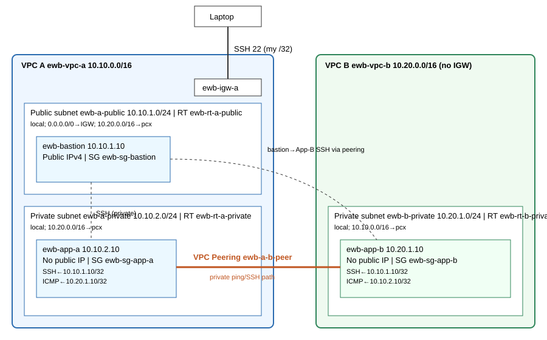

# EWB AWS VPC Peering Project
## Objective
Connect two non-overlapping VPCs with private VPC peering, reach private instances through a bastion (SSH ProxyJump), and prove connectivity, isolation and security-group behaviour with real tests.
## Architecture

2 VPCs, 3 EC2 (Amazon Linux 2023), 1 peering (ewb-a-b-peer), no NAT, IGW only in VPC A.
## CIDR plan
VPC A 10.10.0.0/16 (public 10.10.1.0/24, private 10.10.2.0/24) · VPC B 10.20.0.0/16 (private 10.20.1.0/24)
## EC2
| Name | VPC/Subnet | Private IP | Public IPv4 | SG |
|---|---|---|---|---|
| ewb-bastion | A / public | 10.10.1.10 | yes | ewb-sg-bastion |
| ewb-app-a | A / private | 10.10.2.10 | no | ewb-sg-app-a |
| ewb-app-b | B / private | 10.20.1.10 | no | ewb-sg-app-b |
## Security groups & routing
[security](documentation/security.md) · [routing](documentation/routing.md)
## VPC peering
ewb-a-b-peer, requester VPC A, accepter VPC B, same account/region, status Active (pcx-ID: _fill in_).
## SSH ProxyJump
[commands/ssh-config.txt](commands/ssh-config.txt) — `ssh ewb-app-b` hops through the bastion.
## Testing
Baseline fail (no peering/routes) → forward ping → reverse ping → SSH App-B → private-IP proof → remove App-B ICMP rule (fail) → restore (recover). See `screenshots/` and [testing](documentation/testing.md).
## Key concepts
Peering is non-transitive; routes required both ways; Active ≠ reachable (routes + SGs); SGs stateful, /32 = one host; private subnets have no IGW route; CIDRs must not overlap.
## Cleanup
`scripts/99-cleanup.sh` after evidence saved; see screenshot 14.
## Security
No keys/credentials committed (`.gitignore`).
